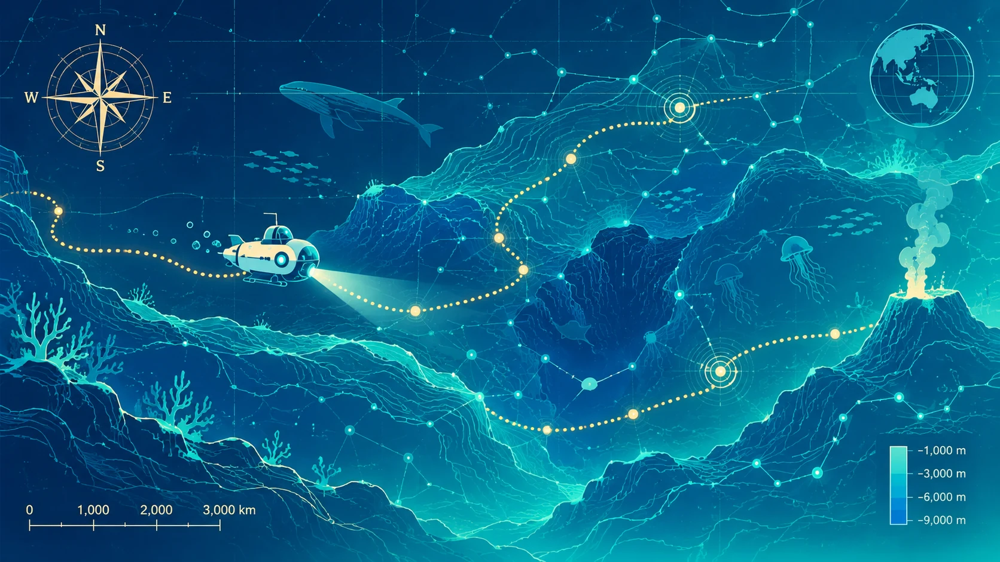
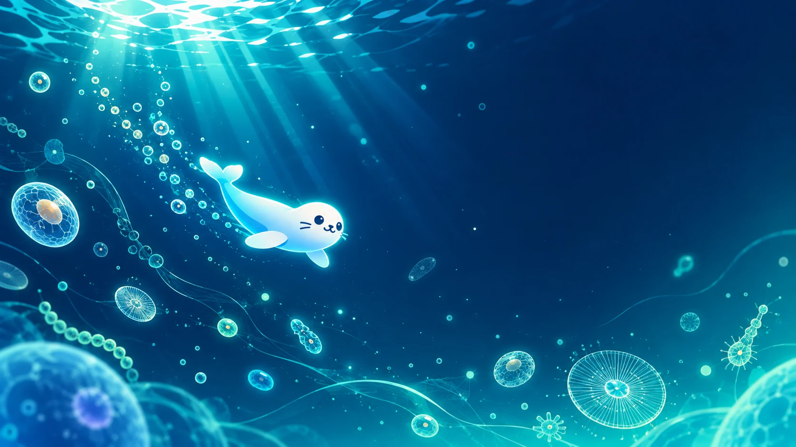

<!-- ============================================================
  SEALab-bio · GitHub Organization Profile README
  渲染位置：https://github.com/SEALab-bio 的 Overview 标签
  本文件必须位于 profile/README.md —— 根目录 README.md 不会显示在组织主页。

  图片一律用 raw.githubusercontent.com 绝对地址：
  组织主页的 base URL 是 /SEALab-bio，相对路径 assets/xxx.webp 会 404。
  视觉构成：首尾 capsule-render 波浪动画（轻量 SVG，带 SEA Lab 字样）+
  assets/ 下自托管 WebP 素材（hero / mascot，合计约 441KB）。
  capsule-render / typing-svg / shields.io 均为境外 CDN，国内偶有加载慢，
  但首尾波浪是整套视觉的骨架，保留。
============================================================ -->

<!-- 🌊 顶部波浪头图（深海渐变 + 淡入动画） -->

<!-- 🦭 Logo 不在此处重复：它已是组织头像，组织页顶部会自动显示 -->

<!-- ⌨️ 打字机动态标语 -->

<!-- 🏷️ 徽章墙 -->

---

## 🌊 The Name

> **SEA** = **S**mart **E**xploration **A**nywhere
> We explore the sea of biology, and we **see** it clearly.
>
> *Welcome aboard.* 🤿

---

<!-- 🌊 深海星图横幅：衔接 The Name 的航海意象（自托管 WebP） -->

  

## 🔬 Research

| | Line | Keywords |
|---|---|---|
| 🧬 | **Stem cell & Aging Biology** | germline stem cells, senescence, epigenetics, anti-aging |
| 🖥️ | **Single-cell & Multi-omics** | scRNA-seq, telocytes, bulk deconvolution, reproducible pipelines |
| 🤖 | **AI for Science** | LLM-assisted research, bioinformatics automation, clinical AI in veterinary medicine |
| 🐾 | **Clinical & Translational** | small animal clinic, traditional veterinary medicine, industry collaboration |

## 📦 Repositories

<!-- 建仓后按实际 repo 更新此表；论文类 repo 建议命名：YYYY_journal_topic -->

| Repo | Type | Description |
|------|------|-------------|
| [`tools/*`](https://github.com/orgs/SEALab-bio/repositories?q=topic%3Atool) | 🧰 Tools | Reusable pipelines & utilities |
| [`papers/*`](https://github.com/orgs/SEALab-bio/repositories?q=topic%3Apaper) | 📄 Papers | Code & reproduction for publications (DOI via Zenodo) |

## 🤝 Join Us

We welcome students and collaborators interested in **computational biology, aging research, and AI applications in veterinary science**. Drop us a line!

## 📮 Contact

📮 alex-hxhuang@nwafu.edu.cn · Northwest A&F University

---

<!-- 🐍 贡献贪吃蛇动画（由 .github/workflows/snake.yml 每日生成，推送到 output 分支）
     注：snk 只支持个人账号、不支持 org，所以图上是实验室负责人个人账号的贡献数据 -->
<picture>
  <source media="(prefers-color-scheme: dark)" srcset="https://raw.githubusercontent.com/SEALab-bio/.github/output/github-snake-dark.svg" />
  
</picture>

<!-- 🦭 收尾暖场：深海发光海豹幼崽（柔和低对比，作情绪收束） -->

  

<!-- 🌊 底部波浪 -->

